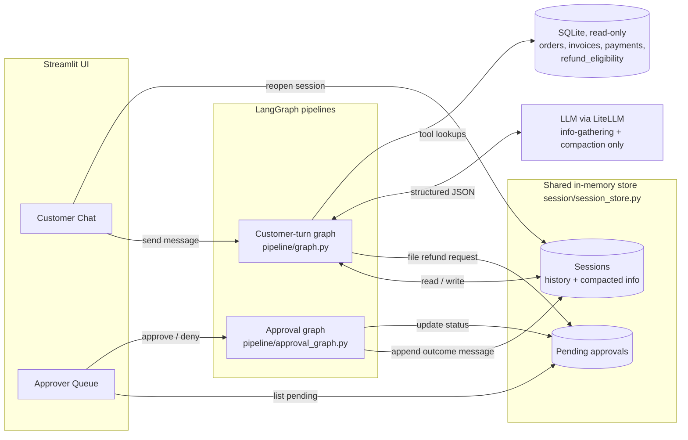
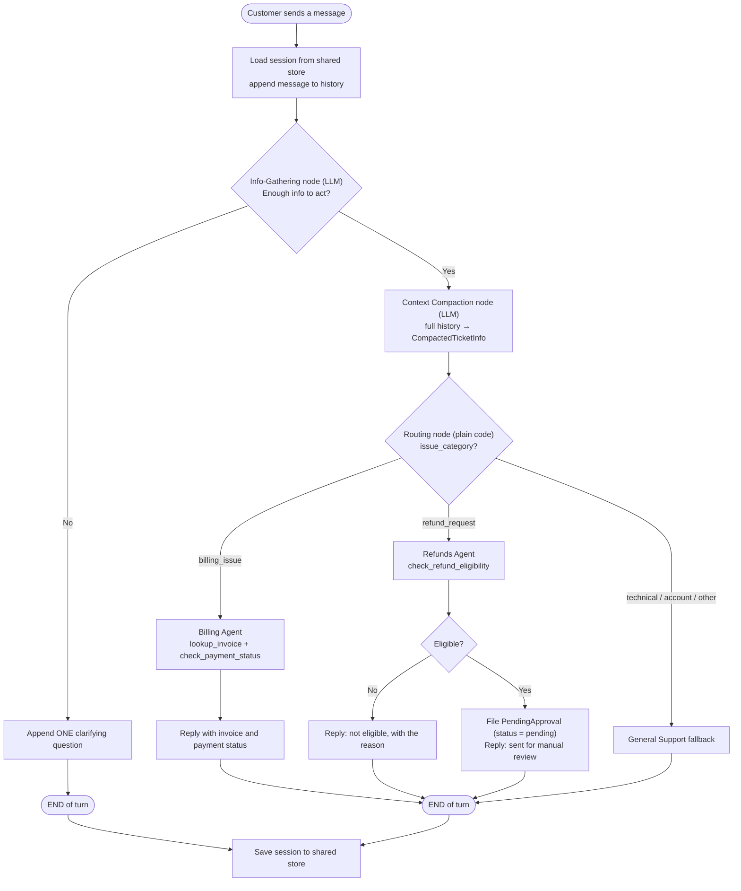
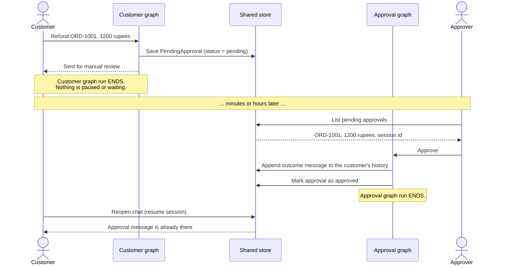

# Multi-Agent Customer Support with Async Human-in-the-Loop

A proof-of-concept customer support bot for an e-commerce store. It chats with customers naturally, resolves low-risk issues automatically, and **never lets the AI approve a refund on its own**. Every refund request goes to a human reviewer, without making the customer wait.

Built with **LangGraph**, **LiteLLM**, **Pydantic**, **SQLite**, and **Streamlit**.

---

## Why this project exists

A chatbot that answers questions is common. What this project demonstrates is a pattern used in real production AI systems (fraud review, content moderation, loan approval, medical triage):

> Let the AI gather information and prepare a decision, but require a human to make any risky decision, **asynchronously**.

The customer is told "your refund is under review" and the conversation moves on. Hours later, an approver clicks Approve or Deny in a separate screen, and the result appears in the customer's chat like a notification that arrived while they were away.

---

## Key ideas

| Concept | Where it lives | In one sentence |
|---|---|---|
| Session | `session/session_store.py` | One shared store lets two different people, acting at different times, affect the same conversation. |
| Conversational memory | `pipeline/state.py` | Every message is kept so the bot can ask follow-up questions across turns. |
| **Context compaction** | `pipeline/compaction.py` | The long transcript is condensed once into a small structured ticket that everything downstream reads. |
| Structured output | `llm/client.py` | The LLM must reply with JSON, which Pydantic then validates. |
| State-machine routing | `pipeline/graph.py` | LangGraph runs the turn as an explicit flowchart; routing is a plain `if`, not an LLM call. |
| Tool use | `tools/mock_tools.py` | Code, not the LLM, queries the database, using parameterized queries. |
| Least privilege | `db/connection.py` | Tools use a read-only SQLite connection, so writes are rejected by the database itself. |
| **Async human-in-the-loop** | `agents/refunds_agent.py`, `pipeline/approval_graph.py` | "Waiting for a human" is a record with `status = "pending"`, not a paused program. |

---

## Architecture

The customer side and the approver side never call each other. **They are connected only through shared storage.**



---

## How one customer message flows

Every path ends within a single graph run. Nothing in this diagram pauses or waits.



Only two nodes call the LLM: **info-gathering** and **compaction**. Routing and both agents are deterministic Python.

---

## The async approval story: two independent timelines



### Why not LangGraph's `interrupt()`?

`interrupt()` models the approval as a **suspended execution**: the graph run is frozen until a human responds. That's the wrong fit when the approver works on their own schedule. Here, "pending" is a plain data value, so the two flows are fully independent and no resume logic is needed.

---

## Project structure

```
Multi_Agent_customer/
├── streamlit_app.py           # entry point: switches between the two views
├── config.py                  # model name, DB path, turnaround hours
├── pyproject.toml             # dependencies (managed by uv)
├── views/
│   ├── customer_chat.py       # customer-facing chat UI
│   └── approver_queue.py      # approver-facing queue UI
├── session/
│   └── session_store.py       # shared store: sessions + pending approvals
├── pipeline/
│   ├── state.py               # schemas: SessionState, CompactedTicketInfo, PendingApproval
│   ├── graph.py               # customer-turn LangGraph
│   ├── approval_graph.py      # separate approval-resolution LangGraph
│   ├── info_gathering.py      # LLM node: enough info? else ask one question
│   └── compaction.py          # LLM node: history -> CompactedTicketInfo
├── agents/
│   ├── billing_agent.py       # calls billing tools, no LLM
│   └── refunds_agent.py       # checks eligibility, files approvals, no LLM
├── tools/
│   └── mock_tools.py          # read-only DB lookups
├── db/
│   ├── schema.sql             # table definitions
│   ├── seed_data.sql          # 12 sample orders
│   ├── init_db.py             # the only code that writes to the DB
│   └── connection.py          # read-only + admin connections
├── llm/
│   └── client.py              # the one place litellm.completion() is called
└── data/                      # generated SQLite file (git-ignored)
```

---

## Getting started

### Prerequisites

- Python 3.11+
- [uv](https://docs.astral.sh/uv/)
- An OpenAI API key (or any provider supported by LiteLLM)

### 1. Clone and install

```bash
git clone https://github.com/<your-username>/Multi_Agent_customer.git
cd Multi_Agent_customer
uv sync
```

### 2. Configure your environment

Create a `.env` file in the project root:

```
OPENAI_API_KEY=sk-your-key-here
LLM_MODEL=gpt-4o-mini
```

| Variable | Default | Purpose |
|---|---|---|
| `LLM_MODEL` | `gpt-4o-mini` | Any LiteLLM model name. Change it to switch providers. |
| `DB_PATH` | `data/support.db` | Location of the SQLite file. |
| `APPROVAL_TURNAROUND_HOURS` | `24` | Shown to customers in the "under review" message. |

> `.env` is listed in `.gitignore`. Never commit your API key.

### 3. Build the database

```bash
uv run python -m db.init_db
```

Re-run it any time to reset to the original 12 sample orders. (The app also builds the database automatically on first run if it's missing.)

### 4. Run the app

```bash
uv run streamlit run streamlit_app.py
```

Open `http://localhost:8501`.

---

## Try the demo

Use **two browser tabs** to play two different people.

**Tab 1, the customer**
1. Select **Customer Chat** and copy the session ID from the sidebar.
2. Type `I want a refund`. The bot asks for the missing details.
3. Type `Order ORD-1001, the headphones broke. 1200 rupees please.`
4. The bot replies that the request was sent for manual review. Open the teaching panels to see the compacted ticket and the tool-call trace.

**Tab 2, the approver**
1. Select **Approver Queue**, expand the ORD-1001 request, and review the compacted ticket.
2. Click **Approve**.

**Back in Tab 1**
1. Paste the session ID into **Resume an existing session ID** and click **Resume**.
2. The approval message, with a confirmation number, is already in the chat.

### Sample orders for testing

| Scenario | Order ID |
|---|---|
| Eligible refund (goes to the approver) | `ORD-1001`, `ORD-1002` |
| Refund rejected: final sale | `ORD-1005`, `ORD-1011` |
| Refund rejected: past the return window | `ORD-1008` |
| Billing: payment pending | `ORD-1003`, `ORD-1007`, `ORD-1012` |
| Billing: payment failed | `ORD-1005`, `ORD-1010` |

---

## Design decisions

- **No `issue_refund` tool exists.** The refund agent physically cannot move money. Every eligible request is filed for a human, at any amount.
- **Saying "no" is automatic; saying "yes" needs a human.** Ineligible refunds are rejected by a database rule. Approvals always go through the approver.
- **One job per LLM call.** "Is there enough info?" and "What is the structured ticket?" are separate prompts, which makes each easier to write and test.
- **Validate at the boundary.** LLM output is validated by Pydantic the moment it arrives; internal code passes plain dictionaries.
- **Safe defaults everywhere.** Missing LLM fields mean "not complete," unknown orders are "not eligible," and any decision other than exactly `"approved"` routes to deny.
- **Shared store instead of `st.session_state`.** Streamlit's session state is private to one browser tab. It's used here only to remember which session a tab is viewing; the data itself lives in the shared store.

---

## Limitations and production roadmap

This is intentionally a POC. Several things are simplified so the core concepts stay visible.

| Area | Now | Production |
|---|---|---|
| Storage | Python dict in memory, lost on restart | Postgres for sessions and approvals, with migrations |
| DB permissions | SQLite read-only connection | Role-based `GRANT SELECT`, connection pooling |
| Auth | Anyone can open any session or the approver view | Customer authentication + role-based access for staff |
| Reliability | No retries; a failed LLM call crashes the turn | Retries with backoff, fallback models, circuit breakers |
| Safety | No PII redaction or prompt-injection defenses | Redact sensitive data; guard against injected instructions |
| Notifications | Customer must reopen the chat | Email, SMS, or push notification on resolution |
| Observability | Streamlit output only | Structured logging, tracing, and metrics |
| Scale | Graph runs block the Streamlit request | Background workers (Celery, RQ) |
| Refund execution | Message only, no money moves | Payment gateway integration with idempotency keys |
| Testing | Manual demo | Unit tests per node + an eval set of sample conversations |
| Secrets | Local `.env` file | A secrets manager (AWS Secrets Manager, Vault) |
| SLA handling | Approvals can wait forever | Escalation rules for approvals past a deadline |

---

## Tech stack

- [LangGraph](https://github.com/langchain-ai/langgraph): state-graph orchestration
- [LiteLLM](https://github.com/BerriAI/litellm): one interface for many LLM providers
- [Pydantic](https://docs.pydantic.dev/): schema validation for LLM output
- [SQLite](https://www.sqlite.org/): embedded, single-file database
- [Streamlit](https://streamlit.io/): UI for both views
- [uv](https://docs.astral.sh/uv/): dependency and environment management